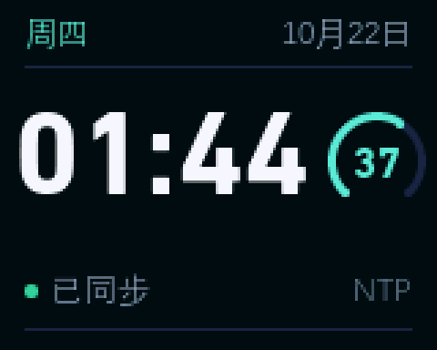
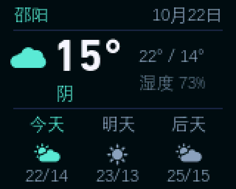
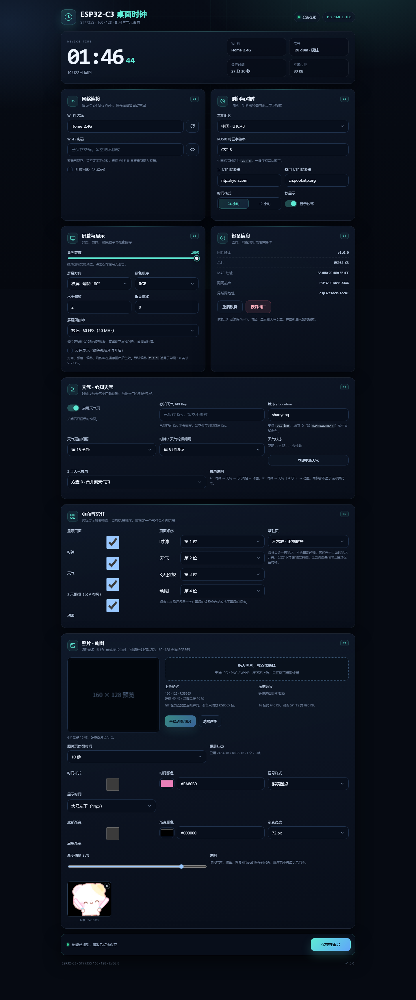

# ESP32-C3 桌面时钟 · ST7735S 160×128

一个基于 **ESP32-C3 + 1.8 英寸 ST7735S** 的桌面时钟，用 **LVGL 8** 绘制界面，带有离线 Web 配网页、天气与三日预报、GIF 动图播放和可调刷新率。

<p align="center">
  
  
  
</p>

<p align="center"><sub>实机帧缓冲截图：时钟页 / 天气页（方案 B，含 3 天预报）/ 照片页</sub></p>



> Web 配置页是单文件内联 HTML/CSS/JS，无 CDN 依赖，断网也能打开。截图中的 SSID、IP、MAC 已替换为示例值。

---

## 下载

- [最新 Release](https://github.com/Empty-City-L/esp32c3-clock/releases/latest)：附带完整源码包 `esp32c3-clock-v1.0.0-source.zip`
- 仓库右上角 **Code → Download ZIP** 也可直接下载源码

---

## 功能

- **160×128 横屏时钟**：DIN 数字大时间、星期/日期、270° 秒环；秒环支持平滑走秒，12/24 小时制可切换。
- **Wi-Fi 配网**：首次上电自动开热点 `ESP32-Clock-XXXX`，手机连热点后访问 `192.168.4.1`，支持 Captive Portal。
- **NTP 对时**：可配置时区、主/备 NTP 服务器；每 6 小时自动重新对时，断网时靠 RTC 继续走时。
- **天气**：心知天气 v3，当前天气 + 3 天预报；支持 A（独立预报页）/ B（合并到天气页）两种布局。
- **后台拉取天气**：HTTP 请求在独立 FreeRTOS 任务里执行，不阻塞时钟、秒环和轮播；失败时保留上一次成功数据。
- **照片 / 动图页**：GIF 最多 16 帧，浏览器逐帧裁切为 160×128 RGB565 后上传；支持时间样式、颜色、冒号和底部渐变。
- **页面轮播**：可配置显示哪些页面、轮播顺序、停留时间以及常驻页。
- **Web 可调刷新率**：标准 10 MHz / 30 ms、流畅 20 MHz / 20 ms、极速 40 MHz / 16 ms。
- **页面切换动画**：整页上移 + 淡入；刷新率越高越顺滑。
- **全部配置持久化**：Wi-Fi、显示、天气、页面、照片样式分别存入 NVS / SPIFFS，支持恢复出厂。
- **调试接口**：`/api/status`、`/api/weather`、`/api/screenshot.raw`，方便查看设备状态和抓取真实屏幕帧。

---

## 硬件

- **主控**：ESP32-C3（RISC-V，160 MHz，4 MB Flash，320 KB RAM）
- **屏幕**：1.8 英寸 ST7735S，128×160，横屏显示 160×128，SPI RGB565
- **背光**：GPIO5 PWM 调光

| 屏幕引脚 | 接到 ESP32-C3 | 说明 |
| --- | --- | --- |
| VCC | 3V3 | 不要接 5V |
| GND | GND | 必须共地 |
| SCL / CLK | **GPIO4** | SPI 时钟 |
| SDA / MOSI | **GPIO6** | SPI 数据 |
| CS | **GPIO7** | 片选 |
| RES / RST | **GPIO3** | 复位 |
| DC | **GPIO2** | 命令 / 数据 |
| BLK / BL | **GPIO5** | 背光，PWM 调光 |

> **GPIO2 是 ESP32-C3 的启动 strapping 脚。** 大多数 ST7735S 模块可以正常启动；如果板子反复进入下载模式，在 DC 与 3V3 之间加一个 10kΩ 上拉电阻。
>
> GPIO4/5/6/7 同时是 C3 的 JTAG 引脚，接屏幕没有影响；插着 JTAG 调试器时不要同时驱动这几根线。

---

## 快速开始

推荐使用 **VS Code + PlatformIO**。工程已锁定依赖版本：

- `platform = espressif32@6.5.0`（Arduino-ESP32 2.0.14）
- `lvgl@8.3.11`
- `lovyan03/LovyanGFX@1.1.16`
- `bblanchon/ArduinoJson@6.21.5`

```powershell
pio run                 # 编译
pio run -t upload       # 烧录
pio device monitor      # 查看串口日志
```

首次编译会下载 RISC-V 工具链和依赖库，需要几分钟；之后是增量编译。

> **中文路径**：Windows 下 `riscv32-esp-gcc` 处理中文路径的链接器 `-Map` 输出可能失败，因此 `platformio.ini` 把编译产物放到纯 ASCII 目录 `%LOCALAPPDATA%\pio-build\esp32c3-clock-anim`。源码仍保留在项目目录，不影响编译和烧录。
>
> 本工程默认开启 C3 原生 USB CDC，`Serial` 走 USB。若使用板载 CH340 的 UART 口看不到日志，可删掉 `platformio.ini` 中的 `-DARDUINO_USB_CDC_ON_BOOT=1 -DARDUINO_USB_MODE=1`，改用 `Serial0`。

### 第一次配网

1. 烧录完成后设备自动重启。
2. 如果没有保存过 Wi-Fi，屏幕显示配网提示，设备开启开放热点 `ESP32-Clock-XXXX`。
3. 手机连接该热点，浏览器打开 **http://192.168.4.1**（部分手机会自动弹出）。
4. 选择 **2.4 GHz** Wi-Fi、填写密码，按需设置时区和显示参数，点击 **保存并重启**。
5. 重启后可在同一局域网访问 `http://esp32clock.local` 或路由器分配的 IP。

> ESP32-C3 只支持 **2.4 GHz** Wi-Fi，5 GHz 无法连接。

---

## Web 配置页

| 模块 | 功能 |
| --- | --- |
| 网络连接 | 扫描附近 Wi-Fi、SSID、密码显示/隐藏、开放网络 |
| 时间与对时 | 常用时区、POSIX 时区、主/备 NTP、12/24 小时制、秒环开关 |
| 屏幕与显示 | 亮度实时预览、横屏/翻转 180°、RGB/BGR、水平/垂直偏移、反色、刷新率三档 |
| 天气 | 心知天气 v3 Key、城市、更新间隔、轮播间隔、立即更新、A/B 布局 |
| 页面与常驻 | 显示页面开关、轮播顺序、常驻页设置 |
| 照片 / 动图 | GIF/图片上传、时间样式、颜色、冒号、底部渐变、照片页停留时间 |
| 设备信息 | 固件版本、芯片、MAC、配网热点、mDNS 地址 |
| 维护 | 重启、恢复出厂设置 |

配置保存在以下 NVS 命名空间 / 分区：

| 数据 | 位置 |
| --- | --- |
| Wi-Fi、时区、NTP、显示参数 | `clockc3` |
| 天气 Key、城市、布局 | `weather` |
| 照片页停留时间与样式 | `photo` |
| 页面显示 / 顺序 / 常驻页 | `pages` |
| 动图帧数据 | SPIFFS `/photo.anim` |

> 配网热点是开放热点，Web 页面没有登录密码，仅用于局域网配置；不要把 `192.168.4.1` 暴露到公网。

### 常用接口

| 接口 | 说明 |
| --- | --- |
| `GET /api/status` | 设备状态、Wi-Fi、时间、天气摘要 |
| `GET /api/weather` | 当前天气 JSON |
| `GET /api/config` | 页面配置（密码和 Key 不回显） |
| `POST /api/config` | 保存配置并重启 |
| `GET /api/scan` | 扫描附近 Wi-Fi |
| `GET /api/photos` / `GET /api/photo` | 相册信息 / 当前动图 |
| `POST /api/photo/upload` | 上传 RGB565 动图（multipart，字段名 `photo`） |
| `GET /api/screenshot.raw` | 160×128 RGB565 原始帧，用于调试抓图 |

---

## 界面与布局

### 时钟页

- DIN Next LT Pro Bold 44 px 等宽数字，跳秒不抖动。
- 秒环是 270° 圆弧 + 中心秒数；Web 可关闭秒环。
- 平滑走秒：秒环每 20 ms 步进一次，配合高刷新率档位连续增长。
- 底部状态点：绿色 = 已同步，黄色 = 断网走时。

### 天气页

- 数据来自心知天气 v3，天气文字优先使用接口 `now.text`，图标按文字关键词匹配兜底。
- 天气页提供 **方案 A / 方案 B**：
  - A：时钟 → 天气 → 3 天预报 → 动图
  - B：时钟 → 天气（含 3 天预报） → 动图
- 天气页显示城市、当前温度、天气、最高/最低、湿度；方案 A 还显示风力和更新时间，方案 B 把 3 天预报合并进天气页。
- 拉取失败时保留上一次成功数据，并在 Web 天气状态中显示错误原因。

### 照片 / 动图页

- 支持 GIF（最多 16 帧）和静态图片，浏览器端解码并裁切为 160×128 RGB565。
- 每帧 40 KB，16 帧约 640 KB；SPIFFS 约 816 KB 可用。
- 设备只播放 `ANIM + 帧数 + 延迟 + RGB565 帧` 格式，不做 GIF/JPEG 解码。
- 时间叠加样式：大号/中号/小号，颜色、冒号（原版/圆点/细竖条/无）、底部渐变（颜色、强度、48/56/72 px）。
- 上传新动图会直接替换旧文件；照片页停留时间可设置 10/15/30/60 秒。

### 页面切换

- 页面从下方 10 px 上移并淡入（时钟页 300 ms，其他页 220 ms）。
- 轮播顺序、显示开关、常驻页均在 Web → **页面与常驻** 中设置。
- 所有页面关闭时自动保留时钟；常驻页数据不可用时回到正常轮播。

---

## 屏幕校准

优先在 **Web → 屏幕与显示** 中调整，保存并重启后生效：

| 现象 | 调整 |
| --- | --- |
| 画面上下颠倒 | 方向改为“翻转 180°”（flush 时软件旋转） |
| 边缘黑边 / 彩边 | 调整水平/垂直偏移（默认 `2 / 1`） |
| 颜色像底片 | 打开“反色显示” |
| 红蓝互换 | 切换 RGB / BGR |
| 花屏 / 闪烁 | 刷新率调回“标准”（10 MHz）；仍有干扰可降低 SPI 频率 |
| 完全黑屏 | 先刷 `tools/lcdtest` 自检固件，确认背光、CS、DC、RST 和 SPI 接线 |

> 本机面板实测定版参数：`rotation = 1` + MADCTL `0xA0`（MY|MV），RGB 顺序，偏移 `2 / 1`，SPI 默认 10 MHz。LovyanGFX 默认的 `0x64` 在这块面板上会剪切/镜像，因此主程序强制写入 `0xA0`；刷新时逐行设置 `160×1` 窗口发送，避免长块写入行错位。
>
> 刷新率三档会同时改变 SPI 写入频率和 LVGL 刷新周期。部分 ST7735S 面板在 40 MHz 下可能花屏，此时请使用“标准”或“流畅”。

---

## 资源占用

以当前工程实测（ESP32-C3 / Arduino-ESP32 2.0.14）：

- **Flash**：1,400,612 B（约 1.34 MB），占 3 MB 程序区的 **44.5%**
- **静态 RAM**：45,796 B，占 320 KB 的 **14.0%**
- **LVGL 帧缓冲**：160×128×2 = **40 KB**（整屏刷新）
- **照片帧缓冲**：显示照片页时分配 **40 KB**
- **天气任务**：8 KB 栈，独立于主循环
- **运行时堆**：照片页显示时约 **90 KB** 空闲

> 实际数值会随编译器、库版本和启用功能略有差异。

---

## 目录结构

```
esp32c3-clock/
├── platformio.ini          # 板型、库版本、分区表、构建目录
├── include/
│   ├── board_config.h      # 引脚、屏幕参数、默认时区/NTP
│   └── lv_conf.h           # LVGL 裁剪
├── src/
│   ├── main.cpp            # ST7735S 驱动、LVGL 移植、Wi-Fi/NTP 状态机
│   ├── ui.cpp / ui.h       # 160×128 界面、秒环、页面动画
│   ├── weather.cpp/.h      # 心知天气、后台任务、数据快照
│   ├── settings.cpp/.h     # 主配置 NVS
│   ├── pages.cpp/.h        # 页面显示/顺序/常驻页
│   ├── photo.cpp/.h        # SPIFFS 动图、照片样式
│   ├── web_config.cpp/.h   # HTTP API 与配网逻辑
│   ├── web_ui.h            # 内联 Web 配置页
│   └── fonts/              # lv_font_conv 生成的字体
├── tools/
│   ├── generate_fonts.ps1  # 重新生成字体
│   ├── render_*.py         # 设计预览渲染脚本
│   ├── dump_ui.py          # 从串口导出 LVGL 帧
│   ├── lcdtest/            # 纯色循环自检固件
│   └── panel_probe/        # MADCTL / 寻址探测固件
├── docs/
│   └── screenshots/        # 实机截图与 Web 截图
└── README.md
```

---

## 常见问题

| 现象 | 排查 |
| --- | --- |
| 黑屏 / 白屏 | 确认 BLK 接 GPIO5、VCC 3.3V、共地；刷 `tools/lcdtest` 检查接线；核对 `board_config.h` 引脚 |
| 花屏 / 错位 | 调整偏移；刷新率调回标准；检查 SPI 线长度和干扰 |
| 颜色反相 / 红蓝互换 | Web 打开“反色显示”或切换 RGB/BGR |
| 搜不到配网热点 | 设备可能仍在尝试连接已保存 Wi-Fi（最长 20 秒）；等 20 秒或断电重启 |
| 配网页打不开 | 确认手机连的是 `ESP32-Clock-XXXX`；手动访问 `http://192.168.4.1`；关闭手机流量/代理 |
| 配网后找不到设备 | 查看串口日志 IP；`esp32clock.local` 需要路由器支持 mDNS |
| Wi-Fi 连不上 | 仅支持 2.4 GHz；检查密码、MAC 过滤；可先用手机热点测试 |
| 时间差 8 小时 | 时区应为 `CST-8`（中国标准时间 UTC+8） |
| 烧录失败 `Failed to connect` | 按住 BOOT 再点 Upload；或把 `upload_speed` 降到 `115200` |
| 中文显示成方块 | 把新字补进 `tools/generate_fonts.ps1` 的 `$symbols`，重新生成字体 |
| 2 MB Flash 的 C3 板 | 把 `board_build.partitions` 改成 `min_spiffs.csv`，必要时裁剪字体 |

---

## 说明

- 天气服务使用 [心知天气](https://www.seniverse.com/) v3 API，需要自行申请 API Key；仓库不包含任何密钥。
- 字体由 Windows 自带的 DIN Next LT Pro Bold 和 DengXian 生成，生成的 `src/fonts/*.c` 已包含在仓库中，直接编译即可。
- Web 页面没有鉴权，仅用于局域网配网；请勿将设备暴露到公网。
- 截图由设备 LVGL 帧缓冲与真实 Web 页面生成；网络标识已做脱敏处理。

## 致谢

- [LVGL](https://lvgl.io/)
- [LovyanGFX](https://github.com/lovyan03/LovyanGFX)
- [ArduinoJson](https://arduinojson.org/)
- [PlatformIO](https://platformio.org/)
- [心知天气](https://www.seniverse.com/)
